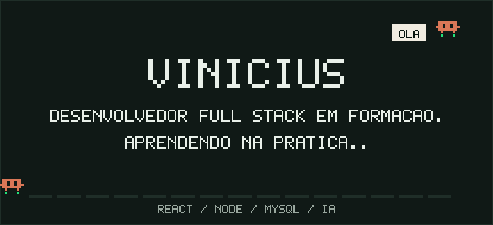
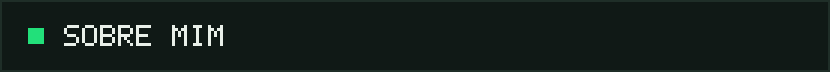
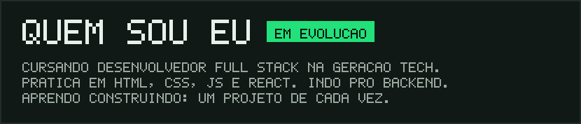
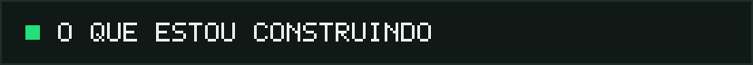
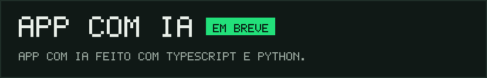
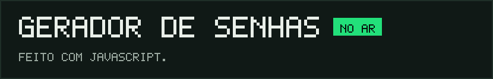
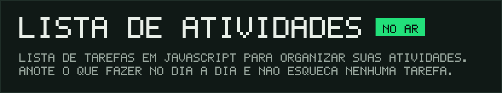
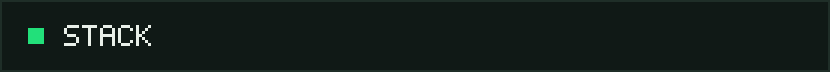
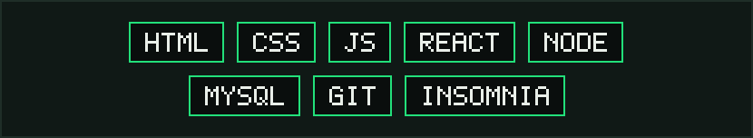
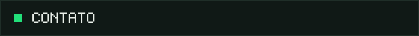

<!-- Troque SEU_USUARIO e SEU_LINKEDIN. Para mudar textos, edite generate.py e rode de novo. -->

  

 

  
  

 

  
  
  
  

 

  
  

 

  
  
  &nbsp;
  
  &nbsp;
  

 

<table align="center" bgcolor="#101916" border="1" bordercolor="#1f2e28" cellpadding="12" cellspacing="0">
    <tr>
        <td align="center">
            
            

                
            

            

                
            

            

                
            

        </td>
    </tr>
</table>
